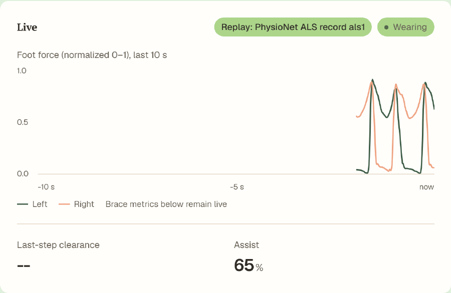
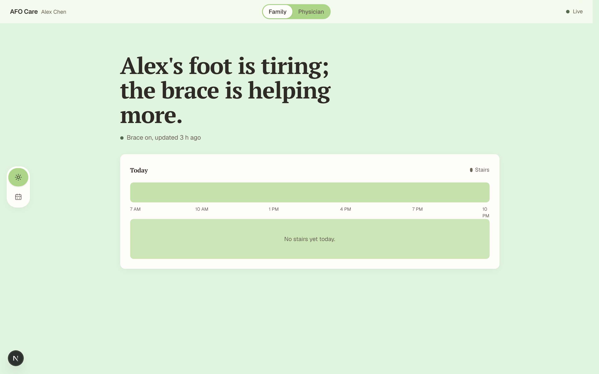
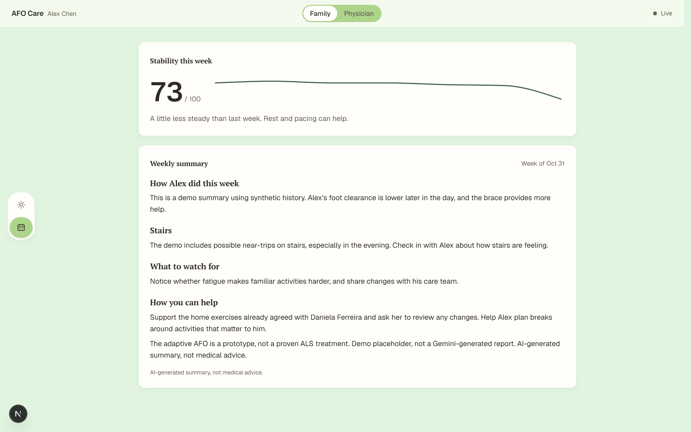
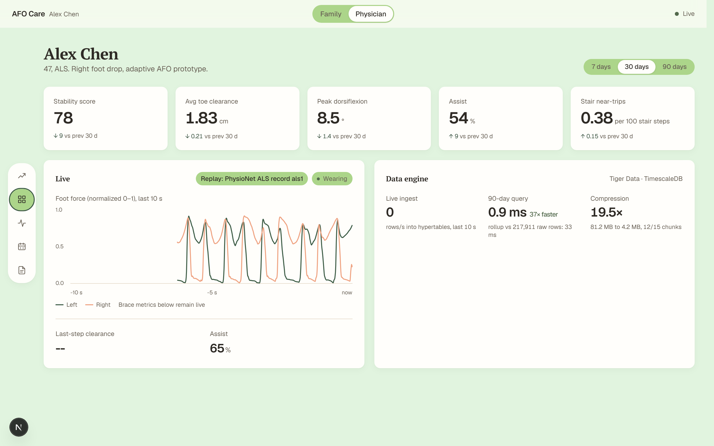
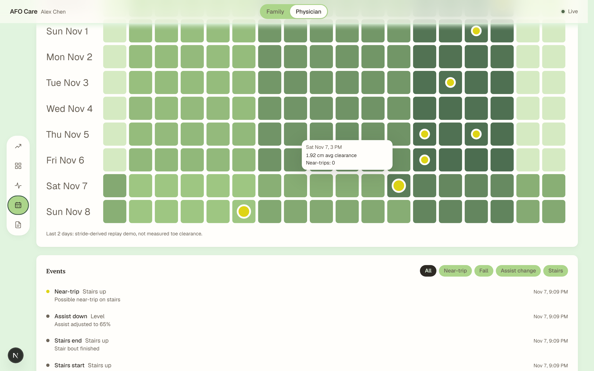
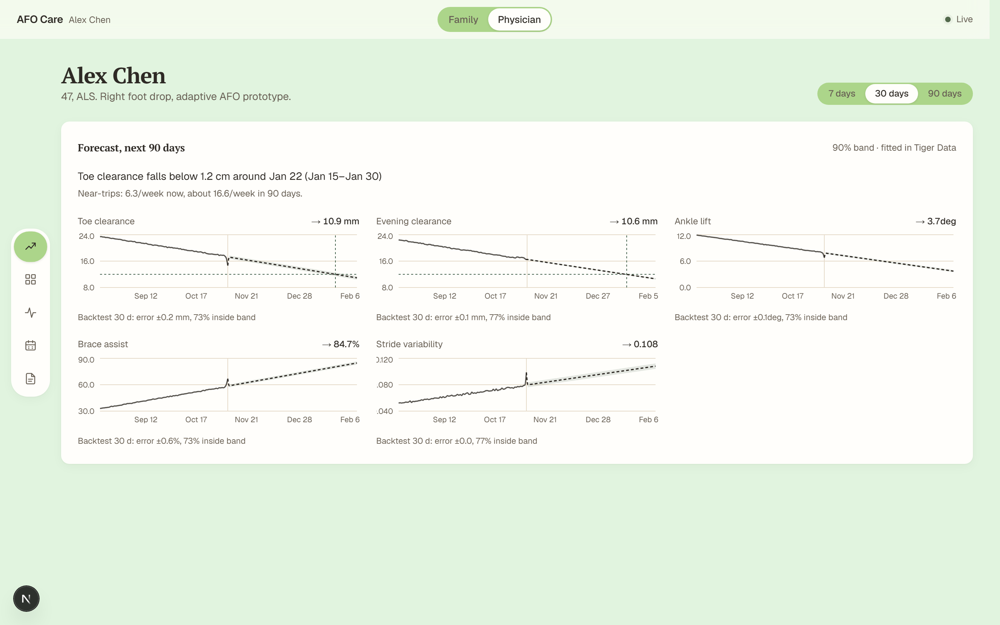
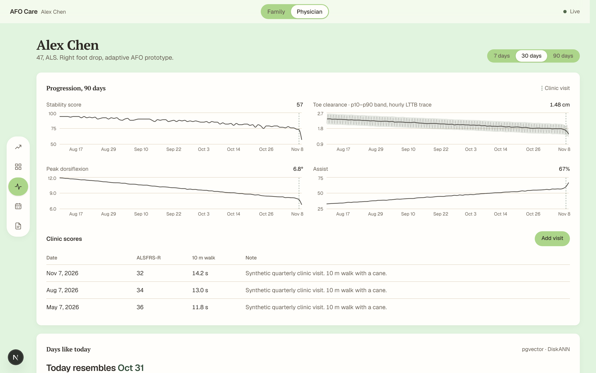
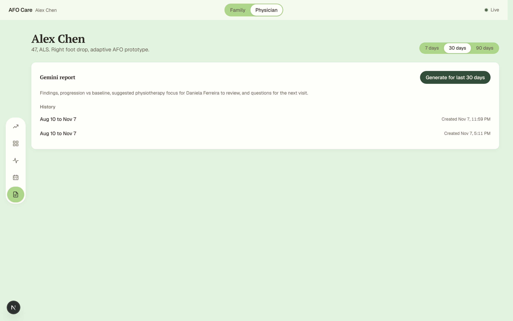
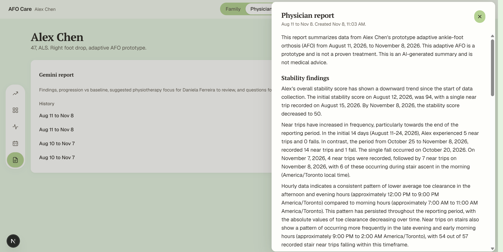

<h1 align="center">Elevait</h1>

<p align="center">BioHacks McMaster 2026</p>

<p align="center">
  
</p>

<p align="center">
  
  
  
  
  
  
  
</p>

<p align="center">
  <a href="#features">Features</a> &bull;
  <a href="#screenshots">Screenshots</a> &bull;
  <a href="#data">Data</a> &bull;
  <a href="#files">Files</a> &bull;
  <a href="#development">Development</a> &bull;
  <a href="#contributing">Contributing</a>
</p>

> Elevait is a care dashboard and backend for an adaptive ankle-foot orthosis (AFO), built for BioHacks McMaster 2026. It follows Alex Chen, the event's fictional patient: a 47-year-old teacher with ALS and right foot drop. Family members see brace status, stair incidents and a weekly summary. Physicians see live ankle movement, gait trends, clinic scores, forecasts and Gemini reports. A simulator and seeded history let the dashboard run without brace hardware.\
> Check it out on [devpost](https://devpost.com/software/elevait?_gl=1*kkec5y*_gcl_au*MjEwOTg1NDYzOS4xNzg5NTIwNzY4*_ga*MTQwMjYxMzIxMi4xNzg5NTIwNzY5*_ga_0YHJK3Y10M*czE3OTQxNzQ0NDEkbzM0JGcxJHQxNzk0MTc0ODUwJGo1NCRsMCRoMA..) or our youtube [demo](https://www.youtube.com/watch?v=eiBGPcBXuTM&source_ve_path=OTY3MTQ&embeds_referring_euri=https%3A%2F%2Fdevpost.com%2F).

## Features

### Family view

- **Today:** a plain-language status sentence, brace wear status and last update, plus a 7 AM to 10 PM timeline of stair bouts, possible trips and falls.
- **Week:** a stability score out of 100, a seven-day sparkline, comparison with the previous week and the latest family report.
- **Check-in alerts:** new near-trip and fall events open an in-page sheet with an "I've checked in" button and a soft Web Audio chime. Browser audio needs a user interaction first.

### Physician view

- **Live monitoring:** a rolling ten-second ankle-angle trace, last-step toe clearance against a 2 cm target, assist percentage, terrain and brace wear status.
- **PhysioNet replay:** in Physician view, press `s` to start a browser-only replay of real PhysioNet `als1` left/right foot force in the Live card. The last two heatmap days fill cell by cell with stride-derived demo values; hover a cell for a floating tooltip with its date, hour, average clearance and near-trip count. Press `s` again to restart.
- **Period comparisons:** select 7, 30 or 90 days for stability, average clearance, peak dorsiflexion, assist and near-trips per 100 stair steps, with changes against the previous period.
- **Progression:** 90-day charts for stability, clearance, dorsiflexion and assist, with clinic visit markers. The clearance chart adds daily percentile bands and a downsampled hourly trace.
- **Clinic visits:** enter a date, ALSFRS-R score, 10 m walk time and optional note; saved visits appear in a table.
- **Time-of-day patterns:** a 14-day clearance heatmap with near-trip markers and hover details. Filter the event list by near-trip, fall, assist change or stairs.
- **Similar days:** compare the latest qualifying gait day with three older days, using standardized clearance, dorsiflexion, stride variability and assist. A separate exploratory indicator compares stride timing with PhysioNet control and ALS cohort averages.
- **Forecast:** project clearance, evening clearance, ankle lift, assist and stride variability for 90 days, with uncertainty bands, threshold crossing estimates and backtest results when enough history exists. These are statistical extrapolations, not clinical predictions.
- **Data engine:** inspect recent ingest throughput, measured raw versus daily-rollup query times and database compression statistics.

### Reports and display

- **Gemini reports:** generate a physician report for the selected range and reopen past reports in a side sheet. Reports cover stability findings, changes against the first 14 days, suggested physiotherapy focus and questions for the next visit.
  Every successful report is saved in `web/reports/` (gitignored). On a Gemini 429, the server reuses the newest saved report for that audience from this directory.
- **Weekly family summaries:** while the server is running, it schedules a report each Monday at 8 AM in the server's local time when both database and Gemini credentials are configured. The reports API also accepts on-demand family requests.
- **Report inputs:** Gemini 2.5 Flash receives aggregates, low-clearance anomaly hours, stair near-trip counts, clinic scores, baseline metrics and stride variability references. Raw ankle samples are not sent. Recommendations are framed as suggestions for the treating physiotherapist to review, and reports display "AI-generated summary, not medical advice."
- **View preferences:** the Family / Physician selection is saved in browser local storage. The interface follows the system light or dark theme and supports reduced motion.

## Screenshots

Screenshots use seeded demo data and the PhysioNet replay.

| | |
| --- | --- |
| [](assets/screenshots/family-today.png)<br>**Family Today** Brace status and today's care timeline. | [](assets/screenshots/family-week.png)<br>**Family Week** Weekly stability and the latest family summary. |
| [](assets/screenshots/physician-overview.png)<br>**Physician Overview** Live PhysioNet foot-force trace and period metrics. | [](assets/screenshots/physician-patterns.png)<br>**Physician Patterns** Filled replay heatmap with a cell's hover details. |
| [](assets/screenshots/physician-forecast.png)<br>**Physician Forecast** Gait projections and uncertainty bands. | [](assets/screenshots/physician-progression.png)<br>**Physician Progression** Longitudinal gait trends and clinic visits. |
| [](assets/screenshots/physician-reports.png)<br>**Physician Reports** Physician report history and summaries. | [] |

## Data

The application uses a single patient ID, `alex-chen`. It accepts timestamped ankle-angle samples, per-step clearance, dorsiflexion, stride time, assist level and terrain, plus care events. The backend receives these measurements; the repository does not include Raspberry Pi firmware or the physical brace controller.

The bundled [Gait in Neurodegenerative Disease Database v1.0.0](data/gait-in-neurodegenerative-disease-database-1.0.0/) contains PhysioNet records for ALS, healthy controls, Parkinson's disease and Huntington's disease. [scripts/physionet.ts](web/scripts/physionet.ts) reads ALS and control right-foot stride intervals, filters them to 600 to 2,500 ms and writes [physionet-strides.json](web/data/physionet-strides.json). These references inform synthetic stride timing, the stability score and exploratory cohort comparisons. Synthetic clearance, ankle angles and assist levels are generated by the project, not measured from those records.

The seed script creates 90 days of synthetic steps and events, three synthetic clinic visits and two explicitly labelled placeholder reports. Those initial reports are not Gemini output. The live simulator generates ankle samples at 100 Hz and sends batches to the ingest API about every 250 ms. The broadcaster limits sample messages to one per 20 ms of sample time.

[web/data/physionet-replay.json](web/data/physionet-replay.json), generated by [web/scripts/physionet-force.ts](web/scripts/physionet-force.ts), bundles normalized left/right foot-force samples and stride intervals from PhysioNet record `als1` for the browser-only `s` replay. The heatmap replay derives demo clearance values from stride timing; these are not measured toe clearance.

### Storage and analysis

- **Time series:** TimescaleDB hypertables store samples and steps. Samples are compressed after three days and retained for 30 days; steps are compressed after seven days.
- **Rollups:** hourly and daily continuous aggregates summarize steps. TimescaleDB Toolkit supplies clearance percentiles, LTTB downsampling and statistical forecast fitting.
- **Similarity:** four-dimensional gait-day vectors use pgvector, with a DiskANN index created through `vectorscale`.
- **Stability:** the project's composite score weights clearance, dorsiflexion against baseline, stride variability, stair near-trips and assist. It is a prototype metric, not a validated clinical scale.

### API

Routes are implemented under [web/app/api](web/app/api/). Date ranges use `from` and `to`; `to` is exclusive.

| Method | Route | Purpose |
| --- | --- | --- |
| POST | `/api/ingest` | Accept `{ samples, steps?, events? }`; validate, store and broadcast measurements and events |
| GET | `/api/status` | Latest wear status, terrain, assist and last-seen time |
| GET | `/api/steps?from=...&to=...` | Steps in a time range |
| GET | `/api/events?from=...&to=...&type=...` | Events, optionally filtered by type |
| GET | `/api/metrics/daily?days=90` | Daily metrics and stability scores |
| GET | `/api/metrics/hourly?days=14` | Hourly clearance and near-trip counts |
| GET | `/api/metrics/clearance?days=90` | Downsampled clearance trace and daily percentiles |
| GET / POST | `/api/clinic-scores` | List visits or add `{ date, alsfrsR?, walk10mSec?, note? }` with at least one score |
| GET | `/api/reports?audience=family` | Report history, optionally filtered by `family` or `physician` |
| POST | `/api/reports` | Generate and save a report from `{ audience, from, to }` |
| GET | `/api/similar-days` | Similar historical gait days and cohort comparison |
| GET | `/api/forecast` | Statistical forecasts for the next 90 days |
| GET | `/api/engine` | Ingest, query timing and compression statistics |
| WebSocket | `/ws` | Push sample, step, event, status and report messages |

This is a single-patient hackathon prototype without authentication. The Family / Physician switch selects a view; it does not enforce access permissions. The adaptive AFO and its analytics are not a proven ALS treatment.

## Files

| What | Location |
| --- | --- |
| Local database connection, Gemini key and port | `web/.env`, loaded by `dotenv` and ignored by Git |
| Example environment variable names | `web/.env.example` |
| Measurements, care events, clinic scores, reports, gait vectors and forecasts | PostgreSQL database selected by `DATABASE_URL` |
| Selected dashboard view | Browser local storage, key `afo-mode` |
| Original gait records | `data/gait-in-neurodegenerative-disease-database-1.0.0/` |
| Derived stride references | `web/data/physionet-strides.json` |

## Development

### Setup / Run

Use Node.js 20 or later and npm. The database must support `timescaledb`, `timescaledb_toolkit` and `vectorscale` with pgvector and DiskANN. A plain PostgreSQL installation without these extensions cannot run the schema as written. The project targets Tiger Data / TimescaleDB.

From the repository root:

```bash
cd web
npm ci
cp .env.example .env
```

On PowerShell, use `Copy-Item .env.example .env` for the copy step. Fill in `web/.env` locally:

| Variable | Use |
| --- | --- |
| `DATABASE_URL` | PostgreSQL connection string; required for database-backed features and setup scripts |
| `GEMINI_API_KEY` | Required for generating Gemini reports; seeded placeholder reports work without it |
| `PORT` | Custom server port; defaults to 3000 when unset |

Initialize the database, add demo history and start the dashboard, all from `web/`:

```bash
npm run db:setup
npm run seed
npm run dev
```

Open `http://localhost:3000`, or the port configured in `PORT`. In a second terminal, also from `web/`:

```bash
npm run simulate
```

The simulator posts to localhost on the same configured port. In an interactive terminal, press `n` to force a stair near-trip, `s` to toggle stairs and `q` to stop. Select Physician > Overview to see the live trace, or Family > Today to see the check-in alert.

For a production build:

```bash
npm run build
npm start
```

Both development and production use `server.ts` to serve Next.js and `/ws` in one process. Deployment needs a persistent Node server with WebSocket support.

### Scripts

Run these from `web/`:

| Command | Action |
| --- | --- |
| `npm run dev` | Start the custom server with Next.js in development mode |
| `npm run build` | Build the Next.js application |
| `npm start` | Start the custom server in production mode |
| `npm run db:setup` | Apply the schema, refresh aggregates and compress eligible chunks |
| `npm run seed` | Replace seed and simulator rows with synthetic history, visits and placeholder reports; refresh rollups |
| `npm run seed:clear` | Delete seed and simulator rows from samples, steps, events, clinic scores and reports; refresh hourly and daily step rollups |
| `npm run seed:clear -- --all` | Delete all rows for Alex from those five tables, including Pi data |
| `npm run simulate` | Stream synthetic AFO measurements to the local ingest API |
| `npx tsx scripts/physionet.ts` | Regenerate derived stride references from the bundled dataset; accepts a dataset directory argument |
| `npx tsx scripts/physionet-force.ts` | Regenerate the browser replay's PhysioNet `als1` foot-force samples and stride intervals |
| `npx tsx scripts/capture.ts` | Capture the README replay GIF and seven viewport screenshots from an already-running seeded app; accepts an optional base URL (default `http://localhost:3000`) |
| `npm run lint` | Run ESLint |
| `npm run typecheck` | Run TypeScript without emitting files |
| `npm run test:e2e` | Run the Playwright Chromium suite |

To regenerate the README media, start the seeded app, install Chromium once with `npx playwright install chromium`, then run `npx tsx scripts/capture.ts [baseUrl]` from `web/`. The script writes `assets/live-replay.gif` and `assets/screenshots/*.png` at the repository root and logs each path.

### Tests

```bash
npm run lint
npm run typecheck
npx playwright install chromium
npm run test:e2e
```

Playwright expects an already-running app at `http://localhost:3000`; it does not start the server. Use a seeded test database and a running simulator for live-trace coverage. The suite posts near-trip events to the database. Its cases cover view switching, live-trace motion, range controls, event filters, visit form expansion, report sheets, check-in alerts, reduced motion and the local PhysioNet replay. Each case opens the section that holds its controls first, and the suite passes as a regression check.

### Layout

```text
README.md                   Project overview and setup
web/
  app/                      Next.js page, layout, styles and API route handlers
  components/family/        Today status, timeline, weekly stability, summary and alerts
  components/physician/     Live trace, metrics, progression, forecasts, events and reports
  components/               Shared controls, charts, navigation and report rendering
  hooks/                    Live connection, data fetching, view preference and audio
  lib/                      Contracts, database queries, ingestion, scoring, analytics and Gemini
  server.ts                 Custom HTTP/WebSocket server and weekly report scheduler
  db/schema.sql             Tables, extensions, hypertables, aggregates and policies
  db/setup.ts               Schema setup and rollup refresh
  scripts/                  Seed, clear-demo, simulator and PhysioNet processing scripts
  data/physionet-strides.json  Derived ALS/control stride references
  tests/animations.spec.ts  Playwright interaction and animation checks
  playwright.config.ts      Chromium test configuration
  .env.example              Environment template
  package.json              Stack dependencies and npm scripts
data/                       Bundled PhysioNet gait database
docs/plan/                  Patient case, event context and alternative concepts
docs/superpowers/specs/     Dashboard design specification
cad-inspo/                  Reference CAD assets
```

## Contributing

Read the [project context](docs/plan/CONTEXT.md), [patient case](docs/plan/PATIENT_CASE.md) and [dashboard design](docs/superpowers/specs/2026-11-07-dashboard-design.md) for the prototype's intent. Some planning documents describe earlier concepts; check the current implementation before extending them. Keep changes grounded in the fictional patient case and distinguish synthetic data, observed measurements and clinical interpretation. For UI bug reports, include the selected view and section, reproduction steps and whether data came from the seed script, simulator or brace.
